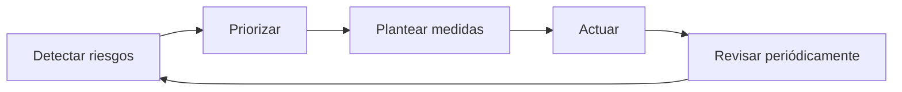
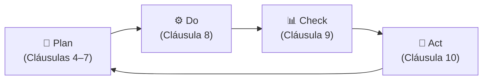

# 📋 ISO/IEC 27001 y el SGSI

ISO/IEC 27001 es una **norma internacional** publicada por la Organización Internacional de Normalización (ISO) junto con la Comisión Electrotécnica Internacional (IEC). Su adopción es **voluntaria**, aunque puede convertirse en obligatoria de facto en ciertos sectores o relaciones contractuales.

La norma proporciona los requisitos para que una organización pueda establecer, implementar, mantener y mejorar de forma continua su propio **SGSI** (*Sistema de Gestión de Seguridad de la Información*).

> **Nota:** ISO 27001 está muy alineada con el ENS español, lo que facilita cumplir ambas normativas de forma simultánea. Ver [ens.md](ens.md).

---

## 🗂️ ¿Qué es un SGSI?

Un **SGSI** es el conjunto de políticas, procesos, roles, responsabilidades y recursos que utiliza una organización para gestionar de forma **sistemática y proactiva** la seguridad de su información, evitando una postura meramente reactiva.

Su objetivo principal es preservar la **tríada DIC**:

| Pilar | Descripción |
| :--- | :--- |
| **D**isponibilidad | La información debe estar accesible cuando se necesite |
| **I**ntegridad | La información no debe ser alterada de forma no autorizada |
| **C**onfidencialidad | Solo los usuarios autorizados deben poder acceder a ella |

> 💡 **Nota:** El ENS español amplía esta tríada a **DICAT**, añadiendo *Autenticidad* y *Trazabilidad*. Ver [ens.md](ens.md).

El SGSI opera mediante un **Sistema de Gestión de Riesgos** cuyo ciclo es:

> ⚠️ **Ejemplo:** Un SOC (*Security Operations Center*) es un componente o herramienta que **forma parte de un SGSI**, no al revés. El SGSI es el marco; el SOC es uno de sus recursos.

---

## 📐 Estructura de la Norma: 10 Cláusulas + Anexo A

ISO 27001 se estructura en **10 cláusulas**. Las más relevantes van de la **4 a la 10**:

| Cláusula | Nombre | Descripción resumida | Fase PDCA |
| :---: | :--- | :--- | :---: |
| 4 | **Contexto** | Análisis del entorno, partes interesadas y alcance del SGSI | Plan |
| 5 | **Liderazgo** | Compromiso de la alta dirección y políticas de seguridad | Plan |
| 6 | **Planificación** | Identificación, análisis y tratamiento de riesgos | Plan |
| 7 | **Soporte** | Recursos, competencias, comunicación y documentación | Plan |
| 8 | **Operación** | Implementación de los controles y medidas planificadas | Do |
| 9 | **Evaluación** | Seguimiento, medición, auditoría y revisión por la dirección | Check |
| 10 | **Mejora** | No conformidades, acciones correctivas y mejora continua | Act |

---

## 🔍 Detalle de las Cláusulas

### Cláusula 4 — Contexto de la Organización
- Analizar el entorno interno y externo de la organización.
- Identificar las **partes interesadas** (*stakeholders*) y sus expectativas:
  - *Clientes*: cumplimiento del [RGPD](rgpd.md).
  - *Entidades reguladoras*: [NIS 2](nis2.md), [ENS](ens.md), etc.
- Definir el **alcance del SGSI**: no es obligatorio incluir todos los sistemas de la organización; se deben priorizar los activos donde el SGSI realmente aporte valor y donde securizarlos no suponga más complejidad que beneficio.

> 📝 **Herramienta habitual en esta cláusula:** Análisis **DAFO/SWOT** (Debilidades, Amenazas, Fortalezas, Oportunidades) para entender el contexto organizativo.

### Cláusula 5 — Liderazgo
- La alta dirección debe demostrar **compromiso activo** con la seguridad de la información.
- Se establecen **políticas internas de seguridad** formales y se comunican a toda la organización.
- Se asignan roles, responsabilidades y autoridades dentro del SGSI.

### Cláusula 6 — Planificación (Gestión de Riesgos)
- Identificar los riesgos sobre los activos definidos en la cláusula 4.
- Evaluar cada riesgo mediante una **metodología de evaluación** (habitualmente una **matriz de riesgos** probabilidad × impacto).
- Priorizar y definir un **Plan de Tratamiento de Riesgos** con los controles del Anexo A a aplicar.
- Establecer revisiones periódicas de los riesgos identificados.

> 📝 **Nota:** El DAFO/SWOT es una herramienta del **contexto (cláusula 4)**, no de la gestión de riesgos (cláusula 6). En la cláusula 6, la herramienta característica es la **matriz de riesgos**.

### Cláusula 7 — Soporte
- Asignar **recursos** (económicos, humanos y tecnológicos) para que el SGSI pueda cumplir con sus responsabilidades conforme la organización crece.
- Garantizar la **formación y competencia** del personal implicado.
- Gestionar la **comunicación** interna y externa sobre el SGSI.
- Mantener la **documentación** requerida por la norma.

### Cláusula 8 — Operación
- Ejecutar y controlar los procesos planificados en la cláusula 6.
- Aplicar los **controles del Anexo A** seleccionados.
- Gestionar cambios y evaluar riesgos asociados a proveedores externos.

### Cláusula 9 — Evaluación del Desempeño
- **Monitorización y medición** continua de la eficacia del SGSI.
- Realización de **auditorías internas** periódicas.
- **Revisión por la dirección** para validar que el SGSI sigue siendo adecuado y eficaz.

### Cláusula 10 — Mejora
- Identificar y gestionar **no conformidades** (incumplimientos de los requisitos de la norma).
- Aplicar **acciones correctivas** para eliminar las causas raíz.
- Impulso constante de la **mejora continua** del SGSI.

---

## 🔁 Metodología PDCA

Aunque no está mencionado de forma explícita en la norma, ISO 27001 está construido sobre el ciclo **PDCA** (*Plan, Do, Check, Act*), que permite afrontar los problemas de forma metódica, escalonada y cíclica:

| Fase | Cláusulas | Descripción |
| :--- | :---: | :--- |
| **Plan** — Planificar | 4, 5, 6, 7 | Analizar contexto, identificar riesgos y planificar controles |
| **Do** — Hacer | 8 | Implementar y operar los controles definidos |
| **Check** — Comprobar | 9 | Medir, auditar y revisar la eficacia del SGSI |
| **Act** — Actuar | 10 | Corregir desviaciones y buscar la mejora continua |

---

## 📎 Anexo A — Controles de Seguridad

El **Anexo A** proporciona un catálogo de **93 controles de seguridad** (ISO 27001:2022) agrupados en 4 categorías:

| Categoría | Descripción |
| :--- | :--- |
| **Organizativos** | Políticas, roles, responsabilidades, gestión de activos |
| **De personas** | Formación, concienciación, acuerdos de confidencialidad |
| **Físicos** | Seguridad de instalaciones, control de acceso físico |
| **Tecnológicos** | Criptografía, gestión de identidades, seguridad en redes |

Los controles a aplicar **no son todos obligatorios**; se seleccionan en función de los riesgos identificados en la cláusula 6.
