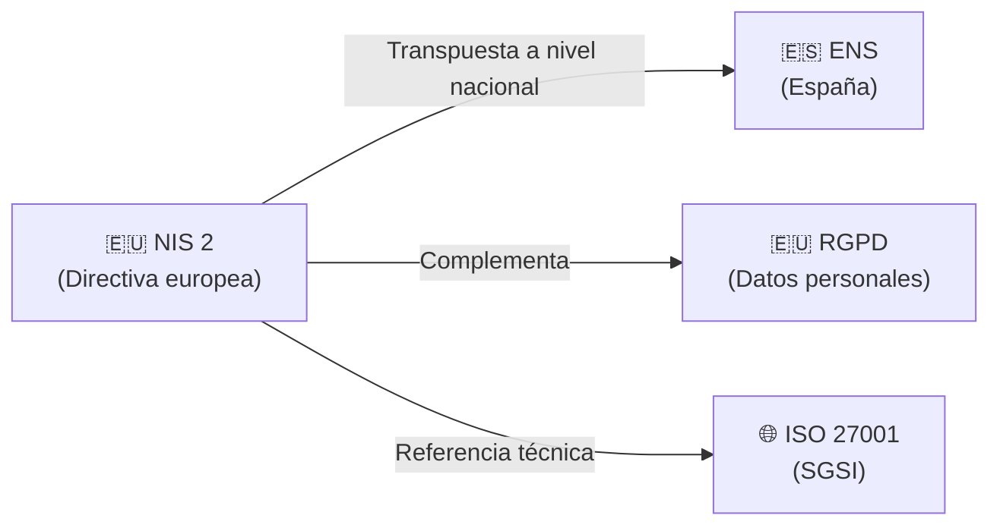

# 🇪🇺 NIS 2 — Directiva de Seguridad de Redes y Sistemas de Información

La **Directiva NIS 2** (Directiva UE 2022/2555) es el marco europeo de ciberseguridad para infraestructuras y servicios críticos. Sustituye a la Directiva NIS original (2016/1148), ampliando significativamente su alcance y endureciendo los requisitos.

---

## 📌 Características Clave

- **Ámbito:** Unión Europea.
- **Obligatoriedad:** Vinculante para todos los estados miembro, pero **cada país debe transponerla** a su legislación nacional (no es de aplicación directa como el RGPD).
- **España:** La transposición nacional del NIS 2 se implementa parcialmente a través del **ENS** y otras normativas nacionales, aunque no son equivalentes oficialmente. Ver [ens.md](ens.md).

---

## 🏢 Entidades Afectadas

NIS 2 clasifica las entidades en dos categorías con diferentes niveles de exigencia:

| Categoría | Ejemplos de sectores | Nivel de supervisión |
| :--- | :--- | :--- |
| **Esenciales** | Energía, transporte, banca, infraestructura de mercados financieros, sanidad, agua potable, infraestructura digital | Mayor — supervisión proactiva por parte de las autoridades |
| **Importantes** | Servicios postales, gestión de residuos, fabricación crítica, química, producción y distribución de alimentos, proveedores digitales | Menor — supervisión reactiva (ante incidentes o denuncias) |

---

## 📋 Principales Obligaciones

| Área | Requisito |
| :--- | :--- |
| **Gestión de riesgos** | Implementar medidas técnicas y organizativas proporcionales al riesgo |
| **Notificación de incidentes** | Notificar incidentes significativos a las autoridades competentes en plazos estrictos (alerta temprana en 24 h, notificación completa en 72 h) |
| **Cadena de suministro** | Evaluar y gestionar los riesgos de seguridad de los proveedores y la cadena de suministro |
| **Responsabilidad de la dirección** | Los órganos de dirección son directamente responsables del cumplimiento y pueden ser sancionados personalmente |
| **Formación** | La alta dirección debe recibir formación periódica en ciberseguridad |

---

## 🔄 Relación con Otras Normativas

