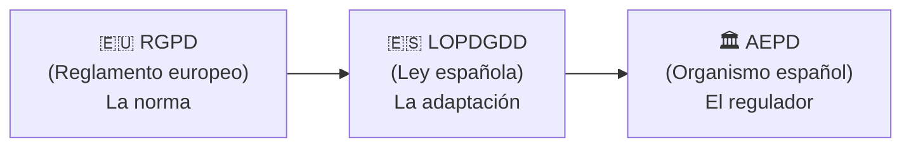

# 🔐 RGPD, LOPDGDD y AEPD — Protección de Datos Personales

El **RGPD** (*Reglamento General de Protección de Datos*, Reglamento UE 2016/679) es el principal marco legal europeo de protección de datos personales. Es de **obligado cumplimiento** para cualquier organización que trate datos de personas físicas identificables, independientemente de su sector o tamaño.

---

## 🧩 Los Tres Elementos del Marco

Estos tres elementos son complementarios y es importante no confundirlos:

| Elemento | Tipo | Descripción |
| :--- | :--- | :--- |
| **RGPD** | Reglamento europeo (2016/679) | La norma de aplicación directa en todos los estados miembro de la UE. Define los principios, derechos y obligaciones en materia de protección de datos. |
| **LOPDGDD** | Ley orgánica española | *Ley Orgánica de Protección de Datos y Garantía de los Derechos Digitales*. Adapta el RGPD al ordenamiento jurídico español y añade **derechos digitales** específicos (derecho al olvido digital, desconexión digital, privacidad en el ámbito laboral…). |
| **AEPD** | Organismo público español | *Agencia Española de Protección de Datos*. Es el organismo regulador y supervisor del cumplimiento del RGPD en España. Puede imponer sanciones, investigar denuncias y emitir directrices. |

> ⚠️ **No confundir:** La **LOPDGDD** es una *ley*; la **AEPD** es la *organización* que vela por su cumplimiento. Son cosas distintas.

---

## 👤 ¿Qué Son los Datos Personales?

El RGPD se aplica a cualquier información relativa a una **persona física identificada o identificable** (*interesado*). Incluye:

- Datos directos: nombre, DNI, correo electrónico, teléfono.
- Datos indirectos: dirección IP, localización GPS, cookies de sesión, identificadores de dispositivo.
- Datos especialmente protegidos: origen étnico, salud, orientación sexual, datos biométricos, ideología política o religiosa.

---

## 📋 Obligaciones Principales para las Organizaciones

| Obligación | Descripción |
| :--- | :--- |
| **Legitimación** | Debe existir una base legal para tratar los datos (consentimiento, contrato, obligación legal, interés legítimo…) |
| **Transparencia** | Informar al interesado de forma clara y accesible sobre cómo se tratan sus datos |
| **Minimización** | Tratar solo los datos estrictamente necesarios para la finalidad declarada |
| **Limitación de finalidad** | Los datos no pueden usarse para fines distintos a los informados |
| **Seguridad** | Implementar medidas técnicas y organizativas adecuadas para proteger los datos |
| **Responsabilidad proactiva** | Demostrar activamente el cumplimiento (*accountability*) |

---

## 🛡️ Derechos del Interesado (ARCO+)

| Derecho | Descripción |
| :--- | :--- |
| **Acceso** | Saber qué datos se tienen y cómo se tratan |
| **Rectificación** | Corregir datos inexactos o incompletos |
| **Cancelación / Supresión** | Solicitar la eliminación de los datos (derecho al olvido) |
| **Oposición** | Oponerse al tratamiento en determinadas circunstancias |
| **Portabilidad** | Recibir los datos en un formato estructurado y legible por máquina |
| **Limitación del tratamiento** | Solicitar que el tratamiento quede suspendido temporalmente |
