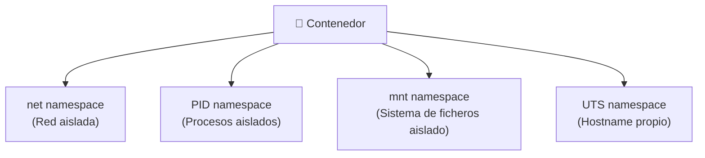

# 🐧 Linux Namespaces

Un **namespace** es una funcionalidad del kernel de Linux que permite crear **subinstancias de red u otros recursos del sistema de forma aislada**, sin necesidad de otro ordenador ni otro kernel ejecutándose. Todos los namespaces comparten el mismo kernel y los mismos procesos y comandos que la máquina anfitriona, pero el recurso concreto que aíslan es completamente independiente.

---

## 📦 Tipos de Namespaces

Existen varios tipos de namespaces, cada uno aislando un recurso diferente del sistema:

| Namespace | Recurso aislado |
| :--- | :--- |
| **Network** (`net`) | Interfaces de red, tablas de enrutamiento, reglas de firewall, puertos |
| **PID** | Árbol de procesos (cada namespace tiene su propio PID 1) |
| **Mount** (`mnt`) | Sistema de ficheros y puntos de montaje |
| **UTS** | Hostname y nombre de dominio del sistema |
| **User** | Identificadores de usuario y grupo (UID/GID) |
| **IPC** | Comunicación entre procesos (colas de mensajes, semáforos) |

---

## 🌐 Network Namespace (netns) — El Más Relevante para Contenedores

El **Network Namespace** aísla todo lo relacionado con la red. Gracias a esto, es posible tener:
- Un proceso `nginx` escuchando en el **puerto 80** dentro del namespace.
- Otro proceso diferente escuchando también en el **puerto 80** en la máquina anfitriona.
- Ambos coexistiendo sin conflicto, porque en términos de red son instancias completamente separadas.

Esto explica el **mapeo de puertos** que se configura en herramientas como Docker (`8080:80`): el tráfico que llega al puerto `8080` del anfitrión se redirige al puerto `80` del network namespace del contenedor.

---

## 🧱 Los Contenedores como Conjunto de Namespaces

Un **contenedor** no es más que un **conjunto de varios namespaces** combinados para formar un entorno mínimamente funcional y aislado de la máquina anfitriona. Cada tipo de namespace contribuye a una dimensión del aislamiento:

Es por esto que los contenedores **destacan y se usan tanto**: ofrecen aislamiento real del entorno sin el coste de virtualizar un sistema operativo completo.

---

## 📎 Ver también

- [cgroups](../procesos/cgroups.md) — Una vez que un contenedor se ejecuta como un conjunto de namespaces, los **cgroups** son el mecanismo del kernel que permite **limitar los recursos** (CPU, memoria, I/O…) que ese conjunto de procesos puede consumir.
