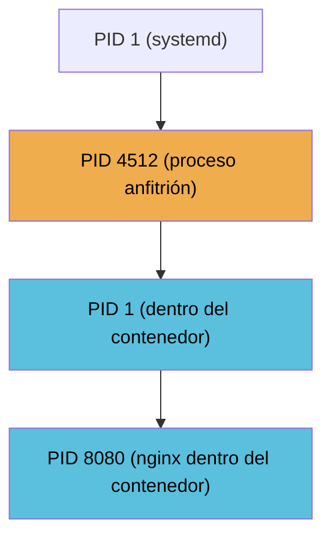

# ⚙️ cgroups — Control Groups

Los **cgroups** (*Control Groups*) son una funcionalidad del kernel de Linux que permite **limitar, priorizar y contabilizar los recursos** (CPU, memoria, I/O de disco, red…) que un proceso o un conjunto de procesos puede consumir.

> 💡 Los cgroups no son exclusivos de los contenedores: se pueden aplicar a **cualquier proceso** que se ejecute en un sistema Linux.

---

## 🌳 Cómo Funcionan: Árbol de Procesos

En Linux, todos los procesos del sistema forman un árbol que cuelga del **PID 1** (`systemd` o `init`). Los cgroups actúan sobre un nodo de ese árbol y sus límites se propagan a **todos los procesos que dependan de él**.



Si un cgroup actúa sobre el **PID 4512** del anfitrión, sus restricciones de recursos se aplican a todo el árbol que cuelga de él, incluyendo los procesos del contenedor.

---

## 📦 cgroups en el Contexto de Contenedores

En el contexto de los contenedores, cada contenedor se ejecuta en el sistema anfitrión como un proceso con su propio PID. Los **cgroups le dicen al sistema operativo**: *"todo lo que cuelgue de este proceso tiene estas limitaciones de hardware"*.

Esto permite, por ejemplo:
- Que un contenedor no pueda consumir más del **20% de la CPU**, aunque el resto esté libre.
- Limitar un contenedor a **512 MB de memoria RAM**.
- Evitar que un proceso descontrolado (OOM, bucle infinito) tumbe el sistema anfitrión completo.

La cadena completa sería:

```
PID 4512 (anfitrión) → cgroup aplicado aquí
    └── PID 1 (contenedor)
            └── PID 8080 (nginx dentro del contenedor)
```

---

## 🔗 Ver también

- [Namespaces](../contenedores/namespaces.md) — Los namespaces son el mecanismo de **aislamiento** del entorno del contenedor. Los cgroups complementan ese aislamiento con la **limitación de recursos**.
