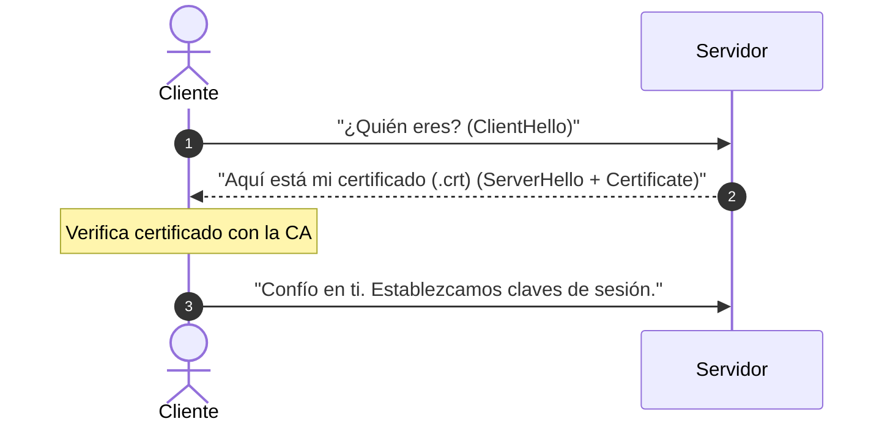
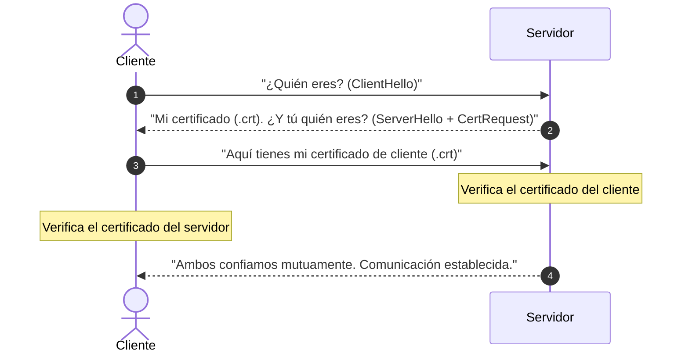
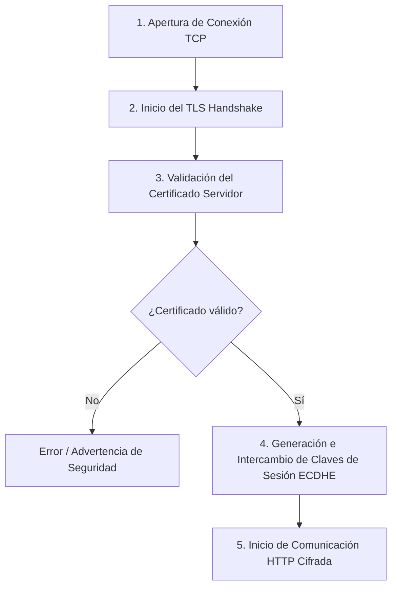
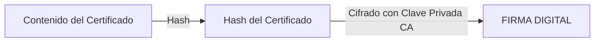
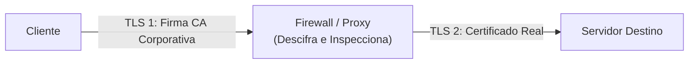

# 🔒 Protocolo TLS / SSL y Seguridad en HTTP

El protocolo **TLS** (*Transport Layer Security*), históricamente conocido como **SSL** (*Secure Sockets Layer*), es el estándar encargado de proporcionar confidencialidad, integridad y autenticidad a las comunicaciones en la web.

> **HTTPS = HTTP + TLS**

---

## 📌 1. Ubicación en la Pila de Protocolos

TLS no pertenece estrictamente a la capa de transporte (TCP) ni a la capa de aplicación (HTTP), sino que opera **entre ambas capas**:

```text
+------------------------------------+
|  Capa de Aplicación (HTTP, FTP...) |
+------------------------------------+
|              TLS / SSL             |  <-- Capa de Seguridad (Intermedia)
+------------------------------------+
|  Capa de Transporte (TCP)          |
+------------------------------------+
|  Capa de Red (IP)                  |
+------------------------------------+
```

El flujo de encapsulamiento para una petición segura es:
`IP` ➔ `TCP` ➔ `TLS` ➔ `HTTP`

---

## 🤝 2. TLS vs mTLS (Mutual TLS)

Durante la conexión se ejecuta el **TLS Handshake** para verificar la identidad de los extremos. Existen dos modalidades principales:

### A. TLS Estándar (Unidireccional)
El cliente verifica la identidad del servidor. Es el modo usado en la web pública.



### B. mTLS (Mutual TLS)
Ambas partes verifican sus identidades recíprocamente. Se utiliza frecuentemente en arquitecturas de microservicios, comunicaciones servidor a servidor (API a API) o entornos empresariales de alta seguridad.



---

## 🔄 3. Pasos en una Petición HTTPS

Cuando un navegador realiza una consulta a una web bajo HTTPS (`https://...`), se sigue el siguiente ciclo de vida:



1. **Conexión TCP:** Se realiza el *three-way handshake* TCP (`SYN`, `SYN-ACK`, `ACK`).
2. **TLS Handshake:** Intercambio de información sobre algoritmos soportados (ciphersuites).
3. **Validación del Certificado:** El cliente comprueba la fecha de caducidad, el dominio y la firma de la Autoridad Certificadora (CA).
4. **Generación de Claves de Sesión:** Mediante algoritmos como **ECDHE** (*Elliptic Curve Diffie-Hellman Ephemeral*), ambas partes generan un par de claves simétricas únicas para esa sesión.
5. **Transferencia de Datos:** Toda la comunicación HTTP viaja cifrada con la clave simétrica acordada.

---

## 🔑 4. Archivos de Configuración: `.crt` vs `.key`

Al configurar un servidor web (como Apache o Nginx) con HTTPS, no es necesario configurar los algoritmos de cifrado manualmente, pero sí proporcionar dos archivos fundamentales:

| Archivo | Tipo de Clave | Visibilidad | Descripción |
| :--- | :--- | :--- | :--- |
| **`.crt`** | Clave Pública + Firma CA | **Público** | Certificado emitido y firmado por una CA. Contiene el dominio, la clave pública del servidor, datos del emisor y fecha de expiración. Se envía al cliente en el handshake. |
| **`.key`** | Clave Privada | **Privado / Secreto** | Contiene la clave privada del servidor. Permite demostrar que el servidor es el propietario legítimo de la clave pública contenida en el `.crt`. |

### Demostración Criptográfica de Propiedad
Para evitar que un atacante copie un certificado público `.crt` e intente hacerse pasar por el servidor real:
1. Durante el handshake, el servidor genera un desafío o prueba matemática utilizando su **clave privada (`.key`)**.
2. El cliente responde o verifica la evidencia usando la **clave pública** extraída del **`.crt`**.
3. Si el resultado es matemáticamente correcto, queda demostrado que el servidor posee la clave privada asociada.

> ⚠️ **Aclaración Importante sobre el uso de `.crt` y `.key`:**
> Que el `.crt` y el `.key` constituyan un par de **clave pública y clave privada** **no significa ni tiene relación alguna con las claves utilizadas para cifrar los datos de la comunicación HTTP**.
> 
> - **Único uso del par `.crt` / `.key`:** Se emplean **únicamente para comprobar que el servidor es legítimo** (demostrar su identidad y verificar la firma de la CA durante el handshake). Ese es su único propósito.
> - **Cifrado del tráfico:** El cifrado real de los datos durante la navegación se realiza mediante **claves simétricas temporales de sesión**, generadas dinámicamente para cada conexión concreta (mediante algoritmos como ECDHE). Esto garantiza además el principio de *Perfect Forward Secrecy* (PFS).

---

## 📜 5. Firma de la Autoridad Certificadora (CA) y Cadena de Confianza

Para garantizar que el archivo `.crt` no ha sido alterado por un atacante ni su clave pública reemplazada:

### Proceso de Firma por la CA
1. La CA toma el contenido del certificado (dominio, clave pública, etc.) y genera un **hash**.
2. La CA cifra ese hash utilizando su propia **clave privada de CA** (desconocida para el público). Ese hash cifrado es la **firma digital**.



### Proceso de Verificación en el Cliente
1. El cliente lee el campo **`Issuer` (Emisor)** dentro del `.crt`.
2. Busca la **clave pública de la CA** correspondiente en su almacén local (*Certificate Store* del sistema operativo o navegador).
3. Descifra la firma digital con la clave pública de la CA para obtener el hash original.
4. Calcula el hash del certificado recibido.
5. **Si ambos hashes coinciden**, el certificado no ha sido modificado y la firma es válida.

> ⚠️ **Nota:** Las claves públicas de las CA raíz ya vienen preinstaladas por defecto en el SO o navegador. Si el emisor no está en el almacén de confianza, el cliente desconfiará del servidor automáticamente.

---

## 🛡️ 6. Inspección TLS (*TLS Inspection* / *MIMT Corporativo*)

En entornos corporativos o empresariales, los firewalls avanzados suelen implementar **TLS Inspection** para analizar tráfico cifrado en búsqueda de malware o fugas de datos.

### ¿Cómo Funciona?
1. La empresa genera su propia **CA Raíz Corporativa** e instala su certificado público en todos los equipos de la organización.
2. Cuando un usuario inicia una conexión a una web HTTPS externa, el firewall **intercepta** la petición.
3. El firewall actúa como un proxy inverso/forward proxy:
   - **Conexión 1 (Cliente ➔ Firewall):** El firewall responde al cliente firmando al vuelo un certificado con su CA corporativa. Como el cliente confía en esa CA raíz, la conexión TLS se establece con éxito sin alertas.
   - **Conexión 2 (Firewall ➔ Servidor Real):** El firewall abre una segunda conexión TLS independiente con la web destino.
4. Al estar situado en medio de las dos conexiones TLS, el firewall puede **descifrar, inspeccionar la carga útil HTTP y volver a cifrar** el tráfico.


